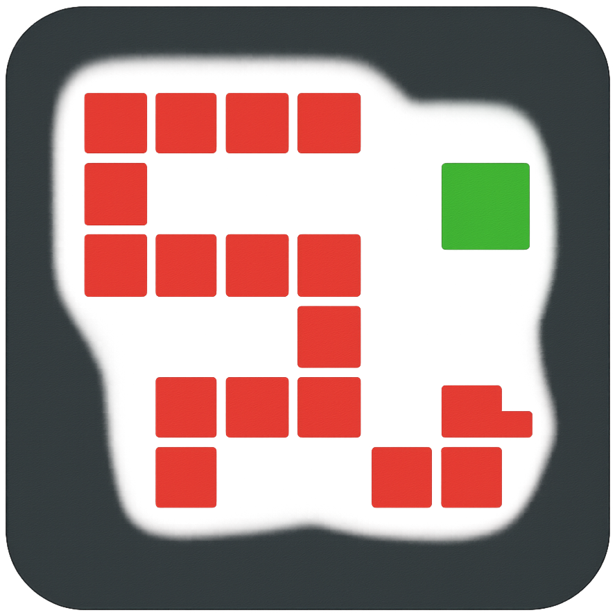

# Snake Game

A simple Python Snake game built with Tkinter.  

---

## Download Pre-built Binary

You can download the pre-compiled game.
- [For Windows](https://github.com/akarshit-1609/Snake_Game_using_Python_Tkinter/releases/download/v2.1.0/snake_game-v2.1-windows.exe)
- [For Linux (AppImage)](https://github.com/akarshit-1609/Snake_Game_using_Python_Tkinter/releases/download/v2.1.0/Snake_Game_glibc-2.31_linux-x86_64.AppImage)

> [!WARNING]
> **⚠️ Windows SmartScreen Warning**
>
> When running the Windows `.exe` binary, Windows SmartScreen may display a **"Windows protected your PC"** warning. This can occur because the executable is not signed with an expensive code-signing certificate.
>
> **How to run the application:**
> 1. Click **"More info"** on the SmartScreen warning.
> 2. Click **"Run anyway"** to proceed.
>
> **🔓 100% Open Source & Transparent**
>
> This project is fully open source. You can review the complete source code in this repository to understand how the application works and verify its behavior before running it. You are encouraged to inspect the code and build the application from source if you prefer.
>
> *This warning does not necessarily indicate that an application is malicious; however, always review the source code and ensure you trust the application before running it.*

---

## How to Play
 - Click or Enter Start button to start or restart the game. 
 - *Left*, *Right*, *Up* and *Down* keys for change direction of snake. 
 - *Left* and *Right* keys for change speed of snake or board cells in a rows and column during hover on the button. 
 - *Esc* key for resign running game.

---

### From Source

1. Clone or download this repository
2. Make sure Python 3.x is installed
3. Run the game through source code or compile with PyInstaller library:

---

## Requirements for Source Code

- Python 3.x installed on your system
- Tkinter and webbrowser library (comes pre-installed with standard Python distributions)

---

## License

This project is licensed under the Apache License 2.0. See the `LICENSE` file for details.

---
